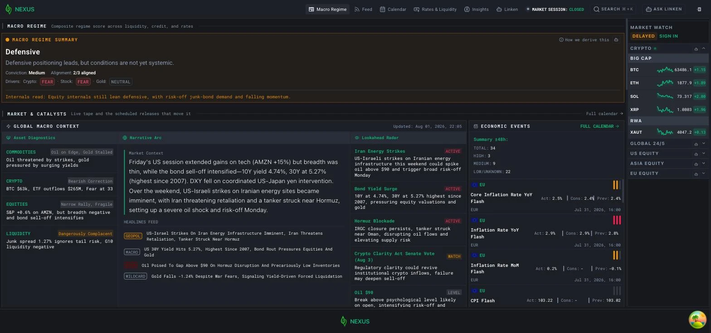

<div align="center">

# Nexus for Android

**Market intelligence, with native Android notifications.**

[Download APK](https://github.com/Omnific-Tech/nexus-android/releases/latest) · [Open terminal](https://nexus.omnific.dev/) · [Discover Nexus](https://nexus.omnific.dev/welcome) · [Documentation](https://docs.omnific.dev/)

</div>

Nexus for Android opens [Nexus Terminal](https://nexus.omnific.dev/) in a Trusted Web Activity and delivers notifications through Android's native notification system. The terminal brings market data, macroeconomic indicators, regulatory filings, prediction markets, news, and AI research into one workspace.

This repository contains the **Android app**: its identity, configuration, icons, and release pipeline. The terminal frontend and backend are maintained separately. Shared Android behavior comes from [Herald Android](https://github.com/Omnific-Tech/herald-android-oss).



## Install

1. Open [GitHub Releases](https://github.com/Omnific-Tech/nexus-android/releases/latest) and download the `.apk` asset.
2. Allow your browser or file manager to install apps when Android prompts, then open the APK.
3. Launch Nexus and allow notifications if you want alerts.

Requires **Android 8.0 (API 26) or newer**, a compatible TWA browser, and an internet connection. The terminal loads from the web; this is not an offline client. Release assets include APK checksums, the signing certificate fingerprint, and dependency notices.

## Build from source

Requires **JDK 21**, Android SDK platform **37.2**, and build-tools **37.0.0**. Set `ANDROID_HOME` and put the SDK command-line tools on `PATH`.

```sh
./gradlew :app:assembleDebug :app:releaseNotices :app:lint
```

Debug APK: `app/build/outputs/apk/debug/app-debug.apk`. Minified, unsigned release APK: `app/build/outputs/apk/release/app-release-unsigned.apk`. Dependency notices: `app/build/outputs/notices/THIRD-PARTY-NOTICES.zip`.

Core **0.1.1** is vendored as a versioned Maven ZIP under `vendor/`. Gradle checks its SHA-256 before extraction; public Android and Firebase dependencies are resolved from their upstream repositories. No private source checkout is required.

| File | Purpose |
| --- | --- |
| `gradle.properties` | Application ID, app/core versions, expected signing certificate |
| `app/src/main/assets/herald.json` | Broker, PWA origin, notification channels, subscription bridge |
| `app/src/main/res/values/strings.xml` | App name, start URL, Digital Asset Links declaration |
| `vendor/PROVENANCE.txt` | Exact core source revision and Maven coordinate |

Firebase client configuration identifies the app; it is not a server credential. Signing keys and server service-account credentials are never included. To build your own product, start with the [Herald Android template](https://github.com/Omnific-Tech/herald-android-oss#create-an-app) and supply your own identity and Firebase project.

## Releases and verification

Version **0.2.1 (1803)** pins Herald core **0.1.1**, including support for up to 500 bridge subscriptions. Application ID `dev.omnific.nexus` and the expected signing certificate remain unchanged for compatible upgrades.

Pull requests and pushes to `main` build debug/release APKs, verify dependency notices, and run Android lint. The manual [app workflow](.github/workflows/build.yml) accepts an explicit version name and increasing version code. With the four `ANDROID_SIGNING_*` repository secrets configured, it builds a signed candidate from the selected branch and retains it as the `nexus-android-<versionCode>` workflow artifact for 14 days. GitHub Release publication additionally requires `main` and `ANDROID_ROLLOUT_ENABLED=true`.

Before enabling rollout, upgrade an existing installation on a physical device. Verify saved subscriptions, notification permission, delivery, notification tap routing, and subscription changes from the terminal. Retain a redacted report with source/dependency versions and APK/certificate checksums. Build checks cannot establish these device behaviors.

The workflow signs the APK, verifies its package ID, version code, certificate, Herald components, and embedded notices, then publishes an `app-<versionCode>` release with `SHA256SUMS`, `SIGNING-CERTIFICATE.txt`, and `THIRD-PARTY-NOTICES.zip`. Version codes must exceed every previous distribution. Preserve the release keystore and Digital Asset Links for in-place updates; a debug build cannot replace a release-signed installation.

## License and related projects

[Apache License 2.0](LICENSE) · [Copyright notice](NOTICE) · [Third-party notices](third_party/README.md)

[Herald broker](https://github.com/Omnific-Tech/herald-oss) · [Herald Web](https://github.com/Omnific-Tech/herald-web-oss) · [Aeon for Android](https://github.com/Omnific-Tech/aeon-android) · [Omnific Tech](https://omnific.dev/)
